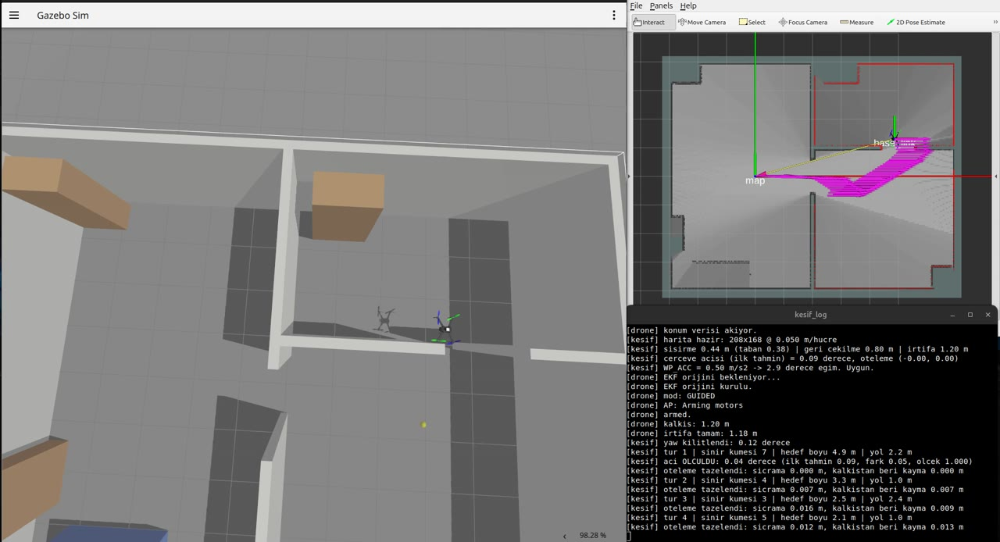
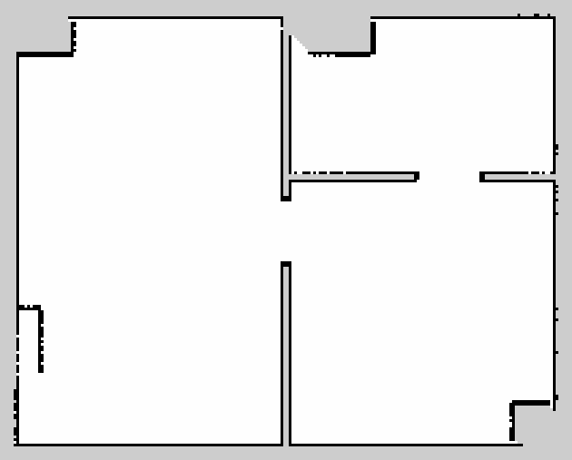
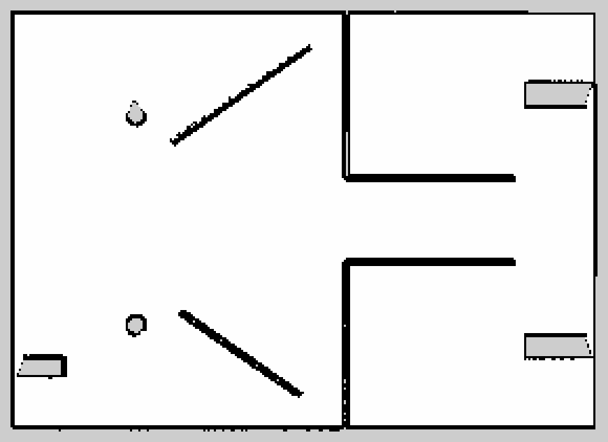

# Drone ile otonom haritalama

Gazebo'da bir evi ve bir kafeyi drone'a kendi başına haritalatıyoruz. Drone'un
üstünde 2D LiDAR var, haritayı Cartographer çıkarıyor. Drone haritada henüz
görmediği yerlerin sınırına uçuyor, gidecek yer kalmayınca kalktığı noktaya
dönüp iniyor. GPS yok, konum tamamen SLAM'den geliyor.



Solda Gazebo'daki drone, sağ üstte o ana kadar çıkan harita, altta da programın
çıktısı var.

## Ne lazım

Ubuntu 24.04, ROS 2 Jazzy ve Gazebo Harmonic. `~/ros2_ws` içinde ArduPilot SITL,
MAVProxy, `ardupilot_gz`, `ardupilot_gazebo` ve `ardupilot_ros` kurulu olmalı.
Bunlara ek olarak `cartographer_ros`, `topic_tools`, Python tarafında da
`pymavlink` ve `numpy`. Kolla uçmak için ayrıca `pygame`.

## Kurulum

```
git clone https://github.com/UnkNoWn17171/drone-frontier-slam.git
cd drone-frontier-slam
mkdir -p ~/bin
ln -sf "$PWD"/bin/* ~/bin/
```

`~/bin` PATH'te olsun. Scriptler projeyi kendi yerlerinden bulduğu için
kopyalamak yerine link veriyoruz.

`~/.bashrc`'nin sonuna:

```
source /opt/ros/jazzy/setup.bash
source ~/ros2_ws/install/setup.bash
export ROS_DOMAIN_ID=42
export GZ_VERSION=harmonic
export GZ_SIM_RESOURCE_PATH=$HOME/ros2_ws/install/ardupilot_gazebo/share:$GZ_SIM_RESOURCE_PATH
export GZ_IP=127.0.0.1
source ~/venv-ardupilot/bin/activate   # MAVProxy ve pymavlink burada
```

Son satır ArduPilot'un kurulum scriptinin açtığı sanal ortam, MAVProxy oraya kuruluyor.

`ROS_DOMAIN_ID` parametre dosyasındaki `DDS_DOMAIN_ID` ile aynı olmak zorunda,
yoksa ArduPilot SLAM'in verdiği konumu hiç görmüyor.

İlk seferde ArduPilot'un parametrelerini yüklemek gerekiyor, iki kez:

1. `slam-baslat durust ev` çalıştır, sim açılınca ne yapacağını yazıp duruyor.
2. Başka bir terminalde `mav`, açılınca `param load ../param_taban.parm`. `GPS1_*` ve `SIM_GPS1_*` için çıkan "Unknown parameter" satırları normal, GPS kapalı.
3. `sim-temizle`, sonra yine `slam-baslat durust ev`. Sim açılınca `mav` ile `param load`'u bir daha yap. Bazı parametreler ancak yeniden açılıştan sonra yükleniyor.
4. `sim-temizle`. Bundan sonrası normal.

## Çalıştırma

Her satır ayrı bir terminalde:

```
sim-temizle ; slam-baslat durust ev       # kafe için: durust kafe
goz                                       # Gazebo'yu izlemek için
mav --out udp:127.0.0.1:14552
cd otonom && python3 engel_kopru.py
cd otonom && python3 kesif.py --kaydet deneme
```

Bitince harita `haritalar/deneme.pgm` olarak kaydediliyor. Her şeyi kapatmak için `sim-temizle`.

Haritayı dünyanın gerçek haliyle karşılaştırmak için:

```
cd otonom && python3 harita_kalite.py deneme --sdf ../ev_sim/ev.sdf
```

## Kolla uçuş

Drone Xbox koluyla elle de uçurulabiliyor. `kesif.py` yerine
`cd manuel && python3 kol_ucus.py` çalıştırılıyor, `mav`'a da
`--out udp:127.0.0.1:14553` ekleniyor. Script drone'u 1.2 m'ye kaldırıp kontrolü
kola veriyor, X tuşu indiriyor. MAVProxy'nin joystick modülü için kol ayarı
`manuel/xbox-series.yml`'de.

Kolla uçarken drone duvara yaklaşınca kendisi duruyor, 0.5 m'den yakına girerse
geri çekiliyor. Bunu ArduPilot'un engelden kaçınması yapıyor, lidar verisini ona
`engel_kopru.py` taşıyor (`AVOID_*` ve `PRX1_*` ayarları `param_taban.parm`'da).
Otonom keşifte bu devrede değil, orada planlayıcı engelleri 0.44 m şişirerek
duvardan uzak duruyor.

## GPS'siz

GPS hiç kullanılmıyor: `GPS1_TYPE`, `SIM_GPS1_ENABLE` ve `AHRS_GPS_USE` 0. EKF
konumu Cartographer'dan, yüksekliği barometreden alıyor. Orijini GPS yerine
`AHRS_ORIGIN_*`'den kuruyor, gerçek drone'da bunlar uçulan yerin yaklaşık
koordinatı olmalı. `slam-baslat` bu ayarları `gpssiz.parm` ile her açılışta
veriyor ve GPS açıksa `HAZIR` demeden duruyor.

## Sonuç

| Ev | Kafe |
|:---:|:---:|
|  |  |
| 12 nesnenin 12'si görüldü | 15 nesnenin 15'i görüldü |
| ortalama hata 2.5 cm | ortalama hata 2.5 cm |
| duvarların %89.8'i haritada | duvarların %100'ü haritada |

Haritalar ve altındaki sayılar son uçuştan. Her dünyada 3 kez uçtuk:

| | Ev | Kafe |
|---|---|---|
| Görevi bitirip kalkış noktasına dönüp inen | 3/3 (%100) | 3/3 (%100) |
| Görülen nesne | her uçuşta 12/12 | her uçuşta 15/15 |
| Duvarların haritadaki oranı (ortalama) | %89.6 | %97.4 |
| Ortalama hata | 2.9 cm | 3.2 cm |

Sayılar `harita_kalite.py` ile, dünyanın `.sdf` dosyasındaki gerçek duvarlara göre
ölçüldü (15 cm tolerans). Kafede diğer iki uçuşta duvar oranı %95-97 arasındaydı,
son uçuşta drone köşelere de girdiği için %100 çıktı.
Evdeki eksiklerin çoğu köşelerdeki dolap, gardırop ve buzdolabının çevresinde,
lidarın o açılardan göremediği yüzeyler.

## Eksikler

LiDAR tek bir yatay düzlemi, 1.47 m yüksekliği tarıyor. Masa, kanepe gibi alçak
eşyalar haritada yok. Drone'un inerken kalktığı yere dönmesi de bu yüzden,
altının boş olduğunu kesin bildiğimiz tek yer orası.

